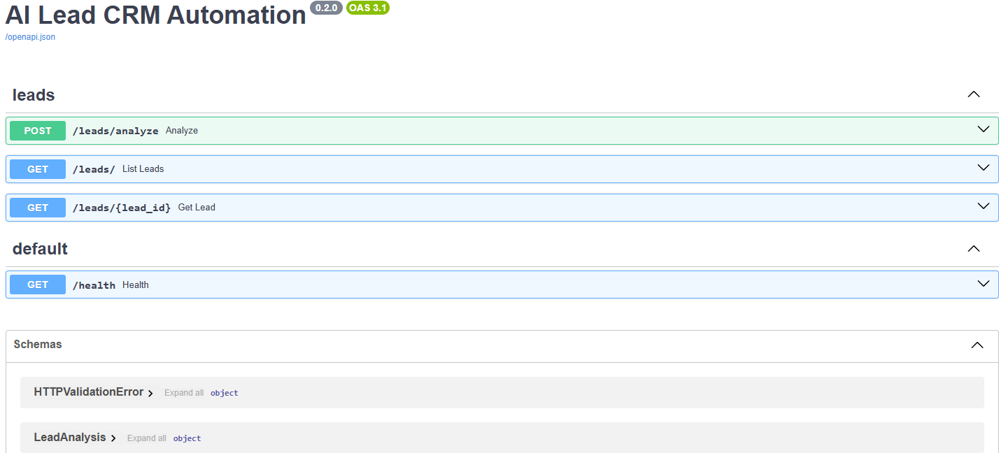
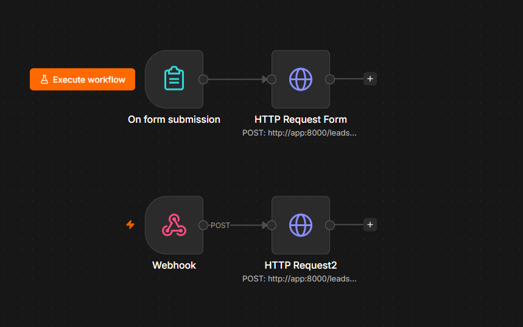
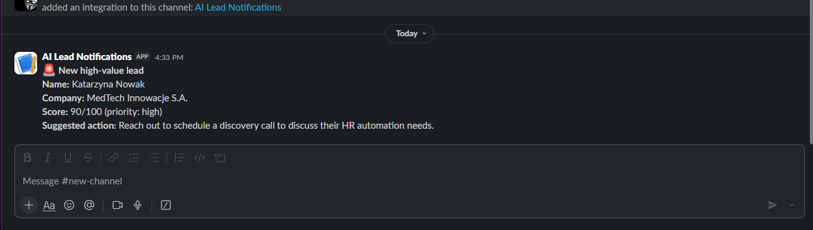
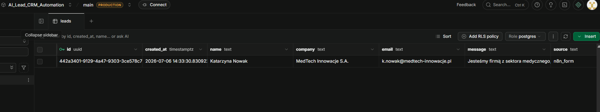

# AI Lead CRM Automation


An AI-powered lead qualification pipeline: n8n captures leads from a web form or webhook, FastAPI scores them with OpenAI Structured Outputs, stores results in Supabase (PostgreSQL), and notifies a human on Slack when a lead is worth immediate attention.

## Overview

```
n8n Form "Contact Us"  ──┐
                         ├──> n8n workflow ──POST──> FastAPI /leads/analyze
n8n Webhook (website) ───┘                              │
                                                        ├── Pydantic validation
                                                        ├── OpenAI gpt-4o-mini (Structured Output)
                                                        │     category, priority, score 0-100,
                                                        │     budget signal, key signals
                                                        ├── Application sets requires_human_followup
                                                        │     (score >= threshold — not the AI)
                                                        ├── Save lead + analysis to Supabase
                                                        └── Slack notification if priority is high
                                                              or score >= threshold
```

The AI only scores and categorizes. No message is ever sent to the lead automatically — a human
reads the Slack notification and decides what happens next. Supabase Table Editor doubles as a
zero-code CRM dashboard.

## Demo

### Lead analysis in Swagger UI



### n8n workflow — two entry points, one executor



### Slack notification for a qualified lead



### Supabase as a CRM dashboard



## Features

- **Workflow orchestration** — n8n receives leads (hosted form + production webhook) and delegates to the API; orchestration and business logic are deliberately separated
- **Structured Output** — OpenAI response is enforced to match a Pydantic schema (`Literal` categories, score bounds 0-100). No free-text parsing
- **Deterministic business rules** — `requires_human_followup` and the Slack notification threshold are computed by the application, not by the AI
- **Human-in-the-loop** — the pipeline ends with a notification, never with an automated reply to the lead
- **Graceful degradation** — Slack or database downtime is logged but never fails the request; OpenAI errors map to meaningful HTTP codes (429/502)
- **Multi-service Docker Compose** — FastAPI and n8n run on one network; n8n reaches the API by service name (`http://app:8000`)
- **Offline tests** — 10 pytest tests with mocked OpenAI, database, and Slack; CI needs no secrets

## Decision Boundaries

- **AI decides:** category, priority, score, company size estimate, budget signal, key signals, suggested action, and confidence.
- **Application decides:** input validation, `requires_human_followup` (score >= `LEAD_SCORE_THRESHOLD`), initial `new` status, whether to notify Slack, persistence, and error mapping.
- **Human decides:** what to do with the lead. The notification is where automation stops.

## Tech Stack

| Layer          | Technology                                  |
| -------------- | ------------------------------------------- |
| Orchestration  | n8n (form trigger, webhook, HTTP request)   |
| API            | Python, FastAPI, Pydantic                   |
| AI             | OpenAI API, gpt-4o-mini, Structured Outputs |
| Database       | PostgreSQL via Supabase, psycopg2           |
| Notifications  | Slack Incoming Webhook                      |
| Tests          | pytest, httpx, unittest.mock                |
| Infrastructure | Docker, Docker Compose                      |

## Project Structure

```
app/
├── main.py                    # FastAPI app, lifespan table auto-create
├── models.py                  # LeadInput, LeadAnalysis, LeadResponse, StoredLead
├── database.py                # psycopg2 connection, leads table DDL
├── routers/
│   └── leads.py               # POST /leads/analyze, GET /leads, GET /leads/{id}
└── services/
    ├── lead_service.py        # OpenAI Structured Output call, followup rule
    ├── supabase_service.py    # INSERT / SELECT on the leads table
    └── slack_service.py       # Notification threshold + webhook POST
n8n/
└── workflows/
    └── lead-intake.json       # Importable workflow: form + webhook -> API
supabase/
└── schema.sql                 # leads table for the Supabase SQL Editor
tests/
└── test_leads.py              # 10 tests, fully offline
sample_data/
└── sample_leads.json          # Example request payloads
docker-compose.yml             # app + n8n on one network
Dockerfile
requirements.txt
pytest.ini
.env.example
```

## Getting Started

### Prerequisites

- Docker Desktop (Compose v2)
- OpenAI API key
- [Supabase](https://supabase.com) project (free tier)
- Slack workspace with an [Incoming Webhook](https://api.slack.com/messaging/webhooks)

### 1. Configure environment

```powershell
Copy-Item .env.example .env   # macOS/Linux: cp .env.example .env
```

```env
OPENAI_API_KEY=<YOUR_OPENAI_API_KEY>
DATABASE_URL=postgresql://postgres.[PROJECT_REF]:[PASSWORD]@[POOLER_HOST]:5432/postgres
SLACK_WEBHOOK_URL=https://hooks.slack.com/services/...
LEAD_SCORE_THRESHOLD=70
```

> **Supabase note:** use the **Session Pooler** connection string (`...pooler.supabase.com`),
> not the direct host (`db.<ref>.supabase.co`). The direct host is IPv6-only and unreachable
> from Docker containers on most setups.

Create the table: Supabase Dashboard → SQL Editor → run [`supabase/schema.sql`](supabase/schema.sql).
(The app also auto-creates it on startup if the database is reachable.)

### 2. Start the stack

```bash
docker compose up -d --build
```

| Service | URL                   |
| ------- | --------------------- |
| FastAPI | http://localhost:8000/docs |
| n8n     | http://localhost:5678 |

### 3. Import the n8n workflow

1. Open http://localhost:5678 and create the local owner account.
2. Workflows → **⋯** → **Import from File** → [`n8n/workflows/lead-intake.json`](n8n/workflows/lead-intake.json).
3. **Publish** the workflow — production URLs only work for a published workflow.
4. Open the **On form submission** node and copy its **Production URL** — that is your live
   "Contact Us" form.

### 4. Send a lead

Through the form (browser), or straight to the API:

```bash
curl -X POST http://localhost:8000/leads/analyze \
  -H "Content-Type: application/json" \
  -d '{
    "name": "Aarav Sharma",
    "company": "Nexa Logistics Pvt. Ltd.",
    "email": "aarav.sharma@nexalogistics.in",
    "message": "We need AI automation for customer support. Team of 80, handling around 500 inquiries per month.",
    "source": "contact_form"
  }'
```

A qualified lead lands in Supabase and triggers a Slack notification within seconds.

### Local development without Docker

```bash
python -m venv .venv
.\.venv\Scripts\Activate.ps1     # macOS/Linux: source .venv/bin/activate
pip install -r requirements.txt
uvicorn app.main:app --reload
```

## API Reference

### `POST /leads/analyze`

Accepts a lead, returns the AI analysis. Saves to Supabase and notifies Slack as side effects
(both are best-effort — their failure never fails the request).

**Request:**

```json
{
  "name": "Aarav Sharma",
  "company": "Nexa Logistics Pvt. Ltd.",
  "email": "aarav.sharma@nexalogistics.in",
  "message": "We need AI automation for customer support. Team of 80, handling around 500 inquiries per month.",
  "source": "contact_form"
}
```

**Response:**

```json
{
  "id": "2fa2ae52-501b-4b5a-8efc-6816d3121733",
  "status": "new",
  "lead": { "...": "echo of the input" },
  "analysis": {
    "category": "automation_inquiry",
    "priority": "high",
    "score": 90,
    "company_size_estimate": "large",
    "budget_signal": "high",
    "requires_human_followup": true,
    "key_signals": ["Team of 120", "budget approved"],
    "suggested_action": "Schedule a discovery call within 24h",
    "confidence": 0.95
  }
}
```

`id` is `null` when the database is unavailable — the analysis still succeeds.

---

### `GET /leads/`

Returns all stored leads, newest first.

---

### `GET /leads/{id}`

Returns a single stored lead with its full analysis. `404` if not found.

---

### `GET /health`

```json
{ "status": "ok" }
```

## Running Tests

```bash
pytest tests/ -v
```

Tests mock OpenAI, the database, and Slack. No API key, network connection, or Supabase project
is required — the same suite runs in CI.

## Sample Data

Ready-to-use request payloads are in [`sample_data/sample_leads.json`](sample_data/sample_leads.json).

## Production Considerations

This project is an MVP focused on demonstrating an AI workflow-automation pipeline. Known gaps
before any production use:

**Security**

- No authentication — anyone who can reach the API can submit or list leads. Production would
  require API key auth on the API and shared-secret validation on the n8n webhook.
- No rate limiting — a burst of form submissions would translate directly into OpenAI spend.
- Secrets live in a `.env` file; production belongs in a secrets manager.
- Lead messages are untrusted model input — prompt-injection review needed before real traffic.

**Reliability**

- No application-level retry or queue — a lead submitted during an OpenAI outage returns 502 and
  is lost unless the caller retries. Production would buffer intake (queue) and retry delivery.
- Duplicate leads are not detected — the same submission creates a new row every time.

**Architecture**

- n8n and the API run on a laptop via Docker Compose; production would host n8n (VPS or n8n
  Cloud) and deploy the API separately so the form is truly available 24/7.
- Lead `status` (`new` / `contacted` / `qualified` / `rejected`) is stored but there is no
  endpoint to update it yet — Supabase Table Editor serves as the manual CRM for now.
- Slack notifications go to a single channel; routing by category or score band would be the
  next step.

**Observability**

- Console logs only; no aggregation, metrics, or tracing.
- The `source` field records the entry path of every lead (`n8n_form`, `website_form`, ...),
  which is the first building block for funnel analytics.
